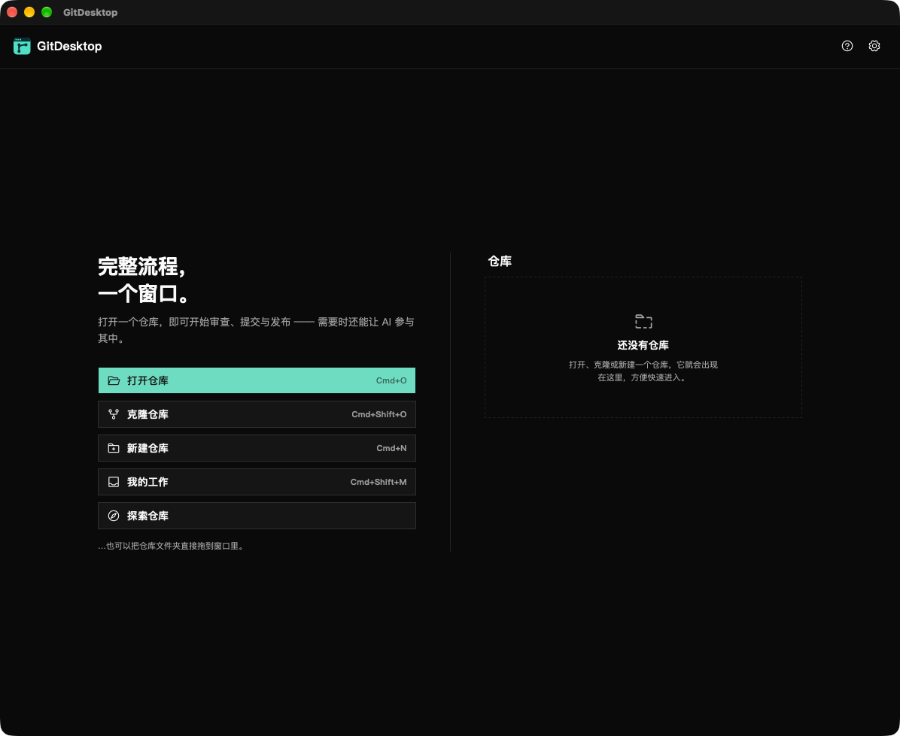
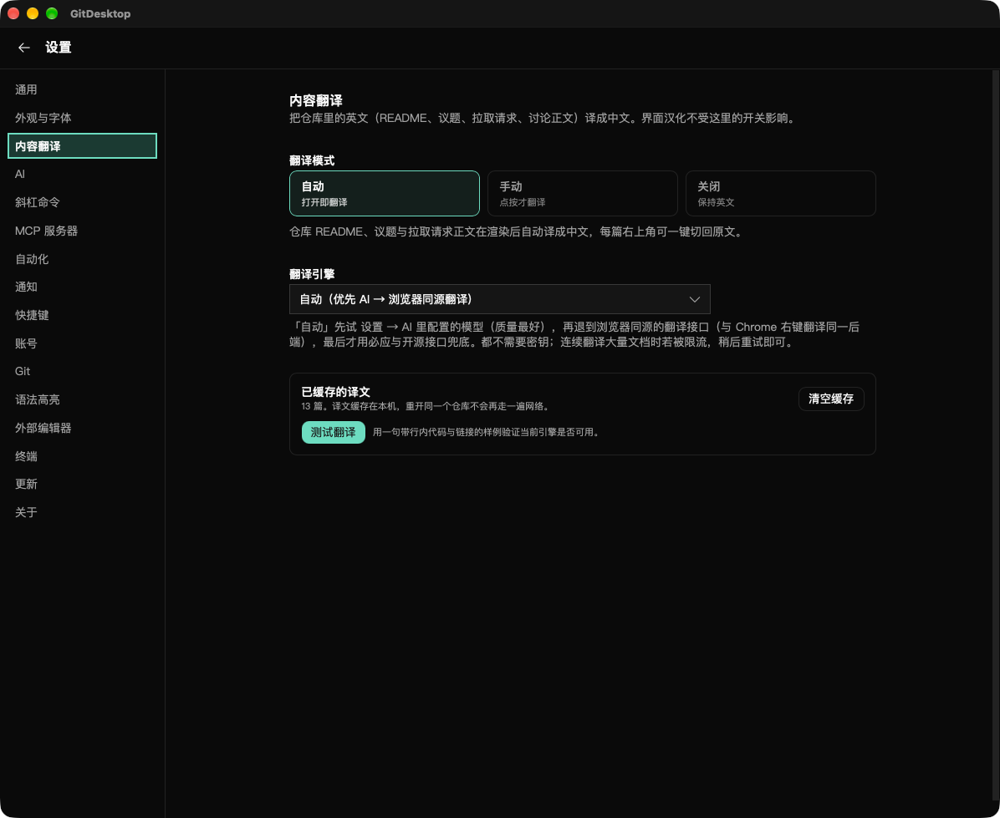
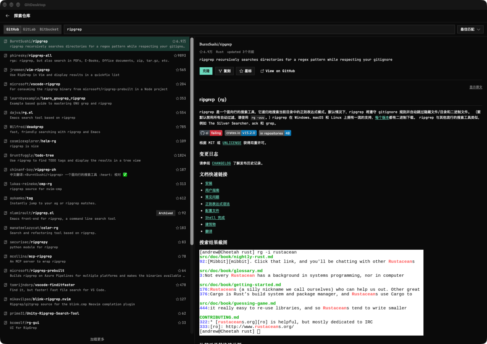
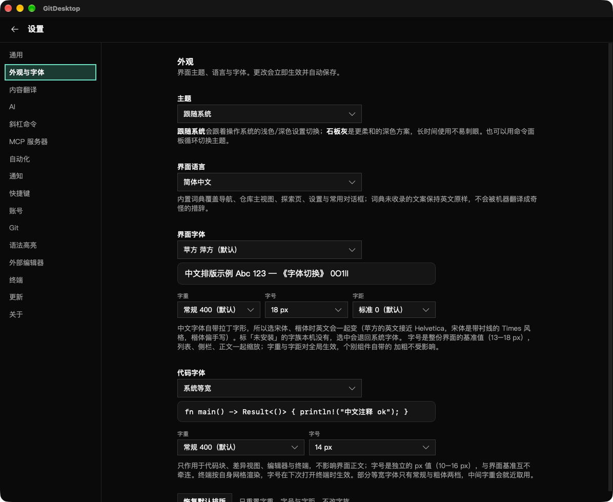
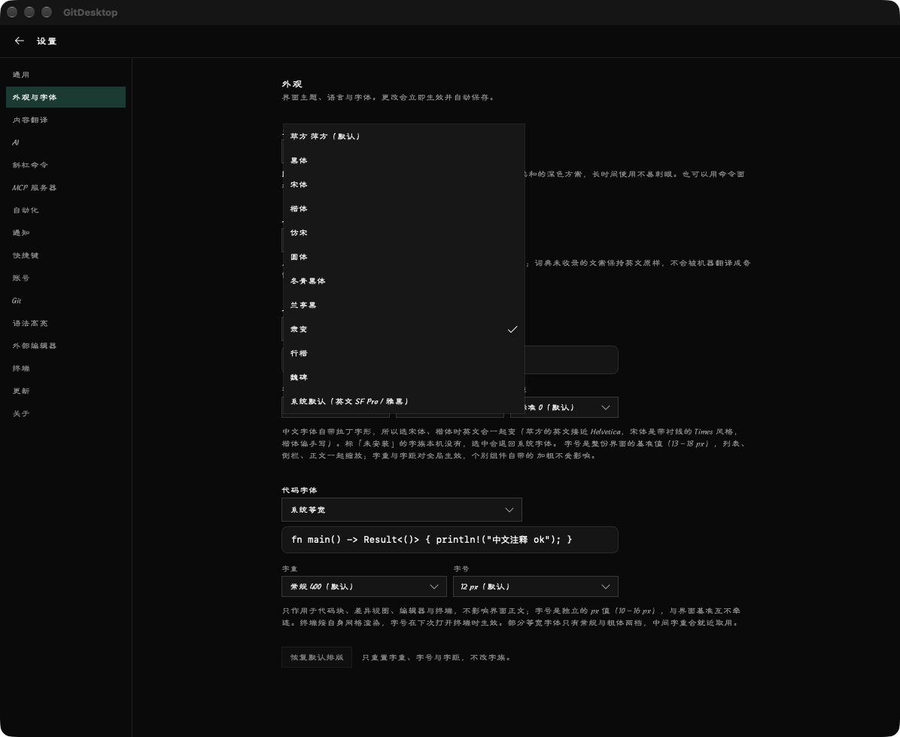
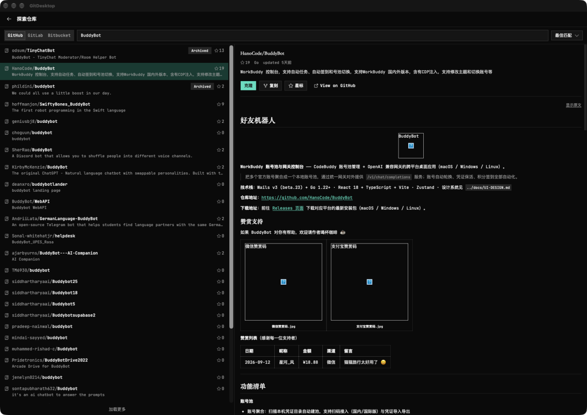
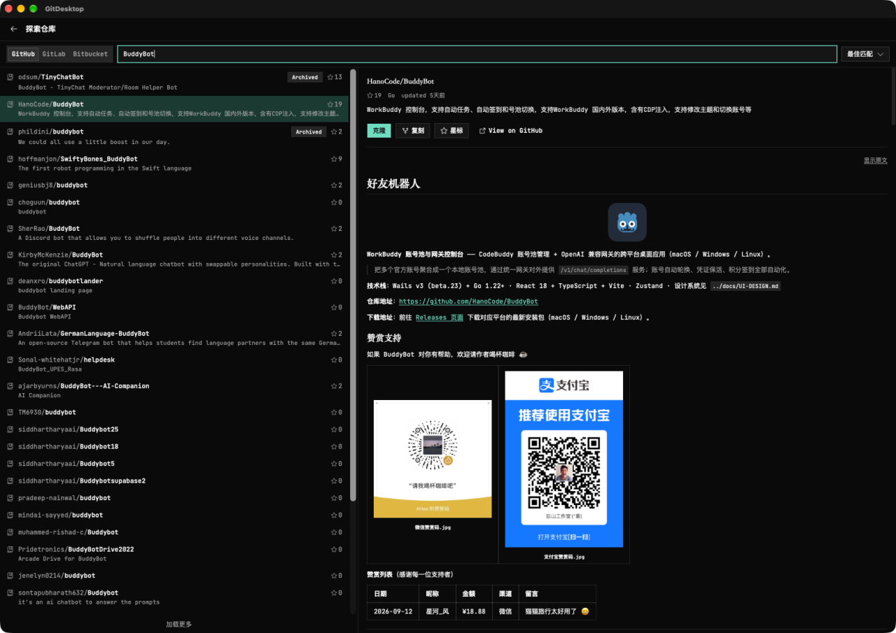

# GitDesktop-ZH

[简体中文](README.md) | **English**

A Chinese-localized build of [theBGuy/GitDesktop](https://github.com/theBGuy/GitDesktop) v0.13.6: Chinese UI, translated repository content, tuned CJK typography, plus a few fixes that affect daily use.



## What this build changes

### 1. Chinese UI (dictionary-based)

Settings → Appearance & Fonts → Interface language switches between 简体中文 and English. Switching back to English restores every rewritten text node and attribute (originals kept in a WeakMap, so they survive React re-renders) — it is not a one-way replacement.

- Covers roughly 330 high-frequency strings: navigation, repository view, explore page, settings panels, common dialogs
- Strings outside the dictionary stay in English rather than being machine-translated into awkward phrasing
- Not a full i18n rewrite: upstream ships ~1,300 UI strings, so deep settings, rare dialogs and error messages remain English

### 2. Repository content translation

Settings → Content translation translates READMEs, issues, pull requests and discussion bodies.



Three modes:

| Mode | Behaviour |
|---|---|
| Auto | Translates on open; each document can switch back to the original with one click |
| Manual | Translates only when you press the button |
| Off | Stays English, sends no requests |

Engine chain, each step falling back to the next: **AI model → browser-native endpoint → Bing → LibreTranslate → MyMemory**. If every step fails the English original is shown unchanged.

Implementation notes:

- Walks the Markdown source line by line and hands out only prose; code fences, table rules, image-only lines and setext underlines stay literal
- Inline constructs (code spans, links, image targets) are masked to `[[n]]` tokens and restored afterwards, so a translator can reorder words without breaking a link
- Paragraph-level swap: the text switches when the translation lands, with no sentence-by-sentence streaming
- 120-entry LRU cache, so reopening the same repository does not hit the network again



### 3. Fonts and typography

Settings → Appearance & Fonts:



- **Interface font**, 12 choices: PingFang / Heiti / Songti / Kaiti / Fangsong / Yuanti / Hiragino / Lantinghei / Libian / Xingkai / Weibei / system default. Families missing on this machine are labelled "not installed" instead of silently falling back
- **Code font**, 7 choices: JetBrains Mono (bundled) / Menlo / SF Mono / Monaco / Consolas / Courier New / system monospace
- **Typography**, 5 controls independent of the family: UI weight 300–600, UI size 13–18 px, UI tracking −0.01 to +0.02 em, code weight 300–600, code size 10–16 px, plus "reset typography"

Size is two independent numbers rather than one scale factor: enlarging the UI should not widen a diff, and enlarging code should not inflate the sidebar. Code size is an absolute px value, so nested `<pre><code>` cannot compound down to half size.

Font availability is measured through DOM layout (does the same string change width when the family is prepended, cross-checked against three generic baselines). The earlier implementation used canvas `measureText`, which in WKWebView returns the fallback width for every on-demand CJK family and mislabelled seven usable fonts as missing.



### 4. Fixes

| Problem | Cause | Fix |
|---|---|---|
| README images all rendered as broken placeholders | Relative paths with Chinese filenames were not rewritten against the repository's raw content root | Resolve against the content root and percent-encode |
| Clicking the Dock icon after closing the window did nothing | The event loop used the `.run(context)` shorthand, which drops macOS `applicationShouldHandleReopen` | Switch to `.build().run(|app, event|)`, handle `RunEvent::Reopen`, and call `app.show()` first to cover Cmd+H |
| Auto-update would revert the UI to English | Update packages are signed by upstream | Cleared `plugins.updater.endpoints`, auto-update disabled |

Image rendering, before and after:

| Before | After |
|---|---|
|  |  |

## Download and install

Grab `GitDesktop_0.13.6_aarch64.dmg` from [Releases](https://github.com/923106608-lang/GitDesktop-ZH/releases).

1. Open the DMG and drag GitDesktop into Applications
2. If macOS says the developer cannot be verified, right-click → Open, or allow it under System Settings → Privacy & Security

Build details:

| Item | Value |
|---|---|
| Version | 0.13.6-zh.1 (based on upstream 0.13.6) |
| Architecture | **arm64** only (no universal build; Intel Macs are not supported) |
| Size | 20 MB |
| Signing | ad-hoc, not notarized |

## Build from source

Requirements: Node 20+, pnpm, Rust stable, Xcode Command Line Tools.

```bash
cd src
pnpm install --frozen-lockfile
source "$HOME/.cargo/env"
pnpm tauri build --bundles app     # -> src/src-tauri/target/release/bundle/macos/GitDesktop.app
pnpm tauri build --bundles dmg     # -> src/src-tauri/target/release/bundle/dmg/*.dmg
```

Note: `--bundles dmg` removes the existing `.app` first. Run `--bundles app` again if you want to keep both artifacts.

## Layout

```
src/                 Full source (React frontend + Rust/Tauri backend)
  src/lib/i18n/      UI dictionary and DOM localizer
  src/lib/translate/ Content translation: segmentation, masking, engine chain, cache
  src/lib/fonts.ts   Font and typography presets
  src/features/settings/  Settings panels
  src-tauri/src/     Rust side: tray, window, git, GitHub API
docs/
  zh-guide.md        Full Chinese implementation and acceptance notes
  install-notes.md   Local install record
  screenshots/       Screenshots
```

## Known limitations

1. The localization is dictionary-based, not a full i18n rewrite; deep settings, rare dialogs and error messages stay English.
2. The default translation engine is a browser-native endpoint, not a public API: it carries no stability promise and may change or rate-limit at any time. If it does, `src/lib/translate/engine.ts` needs updating.
3. Paragraph-level swap, no sentence-by-sentence streaming.
4. Table cells, very short labels and code-only lines are not translated (intentional).
5. Auto-update is disabled: an upstream package would revert the UI to English, and this build is not signed with upstream's key. To update, pull upstream again and redo everything described in `docs/zh-guide.md`.
6. Not code-signed or notarized; copying the app to another machine trips Gatekeeper.
7. The artifact is arm64 only.

## Credits and license

- Upstream: [theBGuy/GitDesktop](https://github.com/theBGuy/GitDesktop), Apache-2.0
- Dictionary reference: [maboloshi/github-chinese](https://github.com/maboloshi/github-chinese)
- This project stays under Apache-2.0; see [LICENSE](src/LICENSE)

The complete implementation and acceptance record (in Chinese) is in [docs/zh-guide.md](docs/zh-guide.md).
